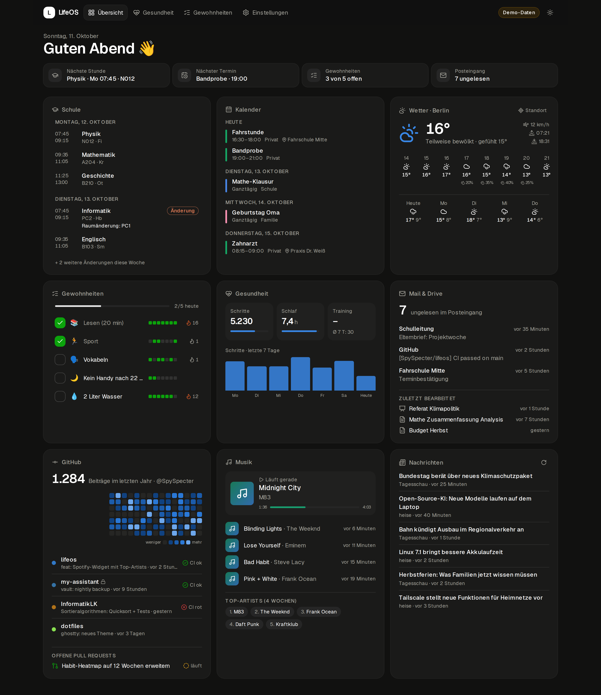
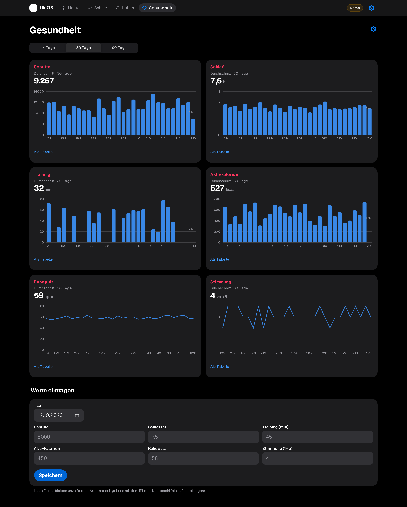
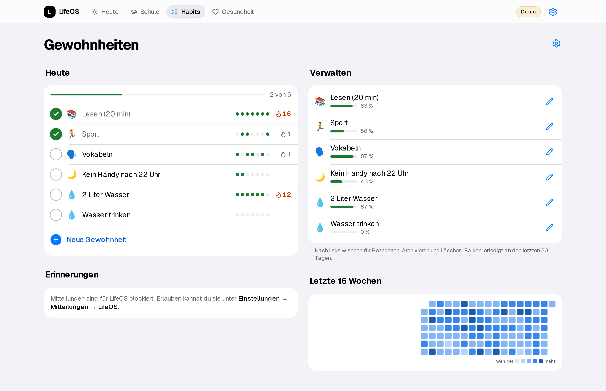
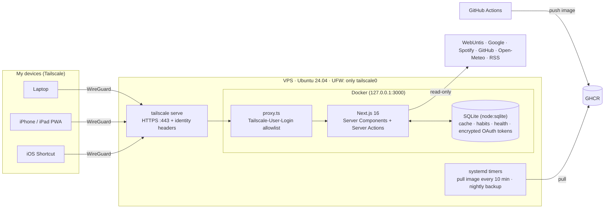

<div align="center">

# LifeOS

**A self-hosted life dashboard — school timetable, calendar, inbox, health, habits, code and music on one screen.**
Runs 24/7 on a 5 € VPS and is reachable **only inside my Tailscale network**.

[](https://github.com/SpySpecter/lifeos/actions/workflows/ci.yml)
[](https://github.com/SpySpecter/lifeos/actions/workflows/release.yml)




</div>

> Screenshots show the built-in **demo mode** (`DEMO_MODE=true`) with fictional data. The UI is in German because it's my personal tool.

## Features

| Widget | Source | Notes |
|---|---|---|
| 🎓 **School** | WebUntis | Today/next school day, double lessons merged, cancellations & substitutions highlighted |
| 📅 **Calendar** | Google Calendar | All visible calendars, next 7 days |
| ✉️ **Mail & Drive** | Gmail, Google Drive | Unread count, latest unread mails, recently edited files (read-only scopes) |
| 🌦 **Weather** | Open-Meteo | Uses the browser's location (rounded to ~1 km), hourly + 5-day forecast |
| ✅ **Habits** | local SQLite | Check off with optimistic UI, streaks, 16-week heatmap |
| ❤️ **Health** | iPhone Shortcut → Apple Health | Daily automation posts steps, sleep, workouts, energy, resting HR; manual entry; 14/30/90-day charts |
| 🧑‍💻 **GitHub** | GraphQL API | Contribution heatmap, recently pushed repos with CI status, open PRs |
| 🎵 **Music** | Spotify Web API | Now playing, recently played, top artists (PKCE, dev-mode-compatible endpoints only) |
| 📰 **News** | RSS / Atom | Tagesschau + heise, interleaved by source |

Plus: dark/light theme, installable PWA for the iPhone home screen, per-widget streaming & error isolation, stale-while-error caching.

<p>
  
  
</p>

## Architecture



**Key decisions**

- **Zero public attack surface.** The container binds to loopback; `tailscale serve` terminates TLS and injects the caller's Tailscale identity, which `src/proxy.ts` checks against an allowlist. After setup, even SSH is closed to the internet.
- **Pull-based deploys.** CI builds and pushes an image to GHCR; a systemd timer on the VPS pulls it. GitHub never needs credentials for the server.
- **One integration contract.** Every data source implements `Integration<T>` (`fetch`, `mock`, `missingConfig`, `ttlSeconds`). `load()` handles caching, demo mode, "not configured" and error states uniformly, so a broken API only affects its own card.
- **No native dependencies.** SQLite comes from Node's built-in `node:sqlite`, so the image needs no build toolchain; migrations run via `PRAGMA user_version`.
- **Secrets stay server-side.** OAuth refresh tokens are encrypted with AES-256-GCM; Google/Spotify scopes are read-only; the health ingest endpoint uses its own bearer token with constant-time comparison.
- **Cache Components / PPR.** The static shell renders instantly; each widget streams in behind its own `<Suspense>` boundary.

More detail in [`docs/ARCHITECTURE.md`](docs/ARCHITECTURE.md).

## Tech stack

Next.js 16 (App Router, Cache Components, Server Actions) · React 19 · TypeScript · Tailwind CSS 4 · shadcn/ui · Recharts · Zod · `node:sqlite` · Vitest · Playwright · Docker · GitHub Actions · Tailscale

## Run it locally

```bash
git clone https://github.com/SpySpecter/lifeos && cd lifeos
npm install
npm run dev:demo        # http://localhost:3000 with demo data, no keys needed
```

With real data: `cp .env.example .env`, fill in what you want (every integration is optional), then `npm run dev`.

```bash
npm test                # 50+ unit tests (parsers, cache, auth, ingest API)
npm run lint && npm run typecheck
docker compose up --build
```

## Deploy

One script turns a fresh Ubuntu 24.04 VPS into a Tailscale-only host running LifeOS (Docker, UFW, unattended upgrades, auto-update and backup timers):

```bash
gh auth login --web -s read:packages
sudo git clone https://github.com/SpySpecter/lifeos /opt/lifeos
sudo bash /opt/lifeos/deploy/bootstrap-vps.sh
```

Step-by-step setup for Google, Spotify, GitHub, WebUntis and the iPhone Shortcut (German): [`docs/SETUP.md`](docs/SETUP.md).

## Project structure

```
src/
  app/              pages, API routes (OAuth, health ingest, healthcheck), server actions
  components/       widgets + UI primitives
  integrations/     one module per data source + load()/cache contract
  lib/              db, crypto, cache, habits, health, access rules, time helpers
  proxy.ts          Tailscale identity check
deploy/             bootstrap script, backup, systemd units
tests/              Vitest suites + fixtures
```

## License

MIT © SpySpecter
